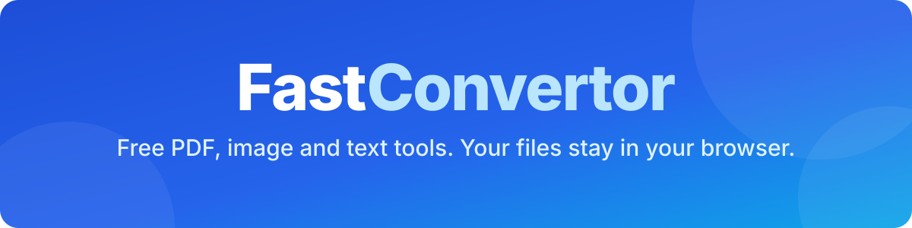

  

  

  
  
  
  

## Convert, edit and compress files without uploading them

Most online converters send your documents to a server. **FastConvertor doesn't.** Every tool runs on your own device, so your contracts, ID scans and photos never leave your browser. No accounts, no watermarks.

## Popular tools

| | |
|---|---|
| [**PDF to Word**](https://fastconvertor.site/pdf-to-word/) | Editable DOCX, with OCR for scanned PDFs |
| [**Merge PDF**](https://fastconvertor.site/pdf-merge/) | Combine PDFs into one document |
| [**Compress PDF**](https://fastconvertor.site/pdf-compress/) | Make large PDFs small enough to email |
| [**Edit PDF**](https://fastconvertor.site/pdf-editor/) | Add text, images, drawings and highlights |
| [**PDF to JPG**](https://fastconvertor.site/pdf-to-jpg/) | Turn every page into an image |
| [**Images to PDF**](https://fastconvertor.site/images-to-pdf/) | Photos and scans into a single PDF |

<b>See all 28 tools</b>

**Document & PDF**
[Word to PDF](https://fastconvertor.site/word-to-pdf/) · [Split PDF](https://fastconvertor.site/pdf-split/) · [PDF Text Extractor / OCR](https://fastconvertor.site/pdf-to-txt/) · [Rotate PDF Pages](https://fastconvertor.site/pdf-page-rotator/) · [Remove PDF Pages](https://fastconvertor.site/pdf-remove-pages/) · [Organize PDF Pages](https://fastconvertor.site/pdf-organize/) · [Add Page Numbers](https://fastconvertor.site/pdf-page-numbers/) · [Add Watermark](https://fastconvertor.site/pdf-watermark/)

**Images**
[Convert Image Format](https://fastconvertor.site/image-converter/) · [WebP to PNG](https://fastconvertor.site/webp-to-png/) · [PNG to JPG](https://fastconvertor.site/png-to-jpg/) · [JPG to WebP](https://fastconvertor.site/jpg-to-webp/) · [Image Compressor](https://fastconvertor.site/image-compressor/) · [Image Resizer](https://fastconvertor.site/image-resizer/) · [Rotate & Flip Image](https://fastconvertor.site/image-rotate/) · [SVG to PNG](https://fastconvertor.site/svg-to-png/)

**Text & developer**
[JSON Formatter](https://fastconvertor.site/json-formatter/) · [Base64 Encoder / Decoder](https://fastconvertor.site/base64-encoder/) · [Word & Character Counter](https://fastconvertor.site/word-counter/) · [Markdown Live Editor](https://fastconvertor.site/markdown-editor/)

**Generators**
[QR Code Generator](https://fastconvertor.site/qr-generator/) · [Lorem Ipsum Generator](https://fastconvertor.site/lorem-generator/)

## Privacy first

Files are processed locally in your browser and are never uploaded. Read the [Privacy Policy](https://fastconvertor.site/privacy-policy/).

## Get in touch

Questions, bug reports or tool ideas: **support@fastconvertor.site** or the [contact page](https://fastconvertor.site/contact/).

---

© FastConvertor. All rights reserved.

